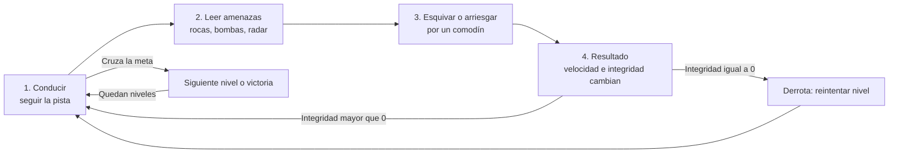
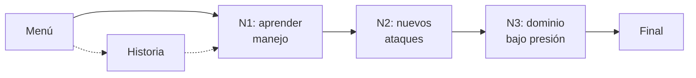
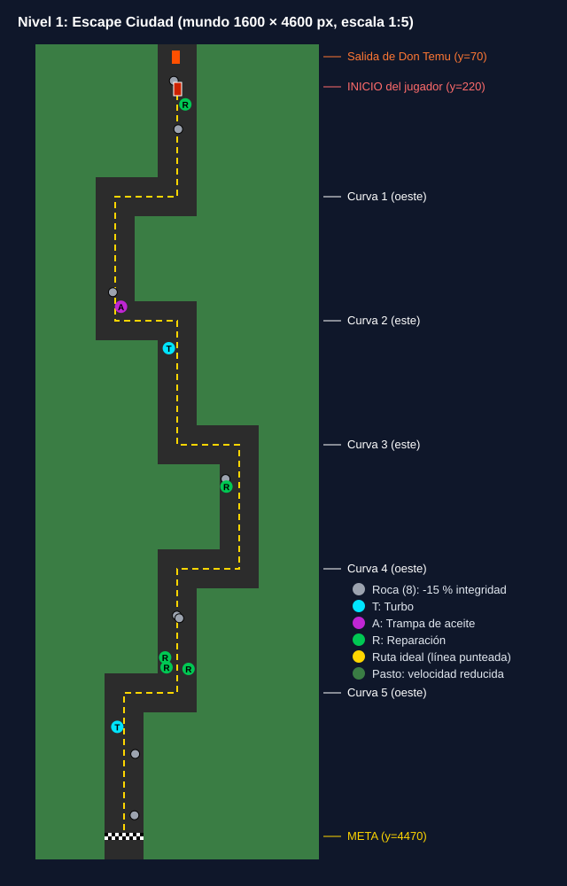
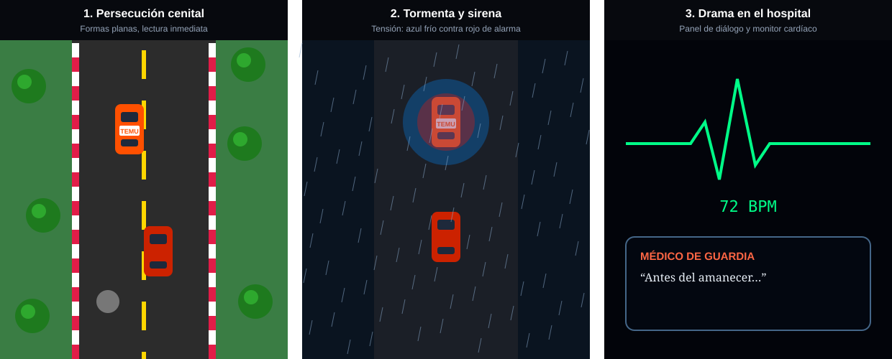
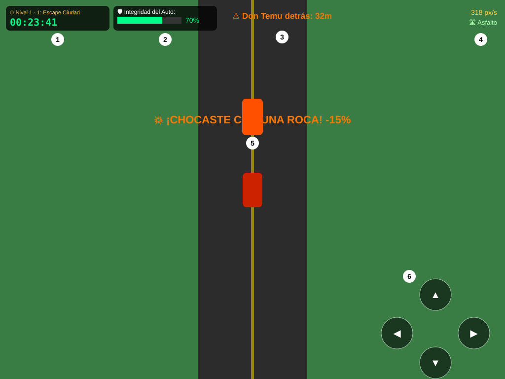
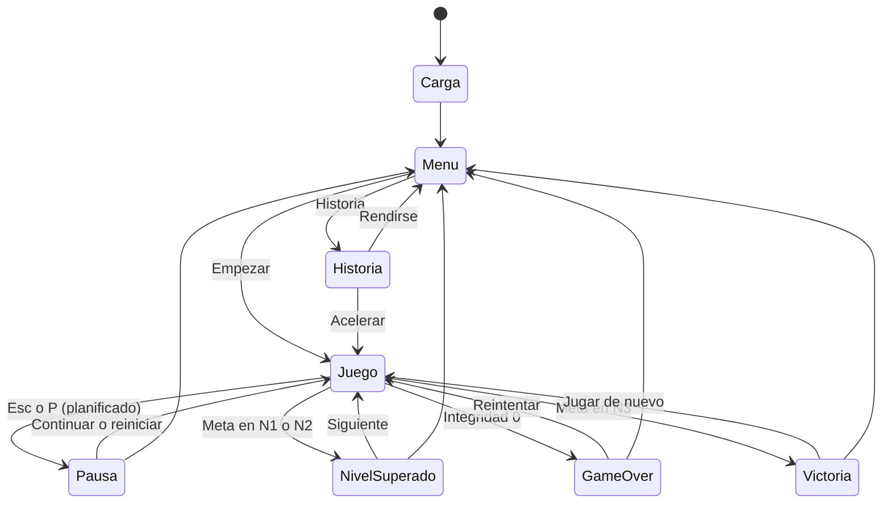

# Game Design Document: Need for Speed Temu's Edition

> Biblia de producción · Versión 1.0 · 26 de noviembre de 2026
> Salvo donde se indique **(planificado)**, todo lo descrito está tomado del prototipo en [`Juego2/`](../Juego2/).

**Contenido:** [1. Ficha técnica](#1-portada-y-ficha-técnica) · [2. Pilares y MDA](#2-pilares-de-diseño-y-experiencia-mda) · [3. Core loop y mecánicas](#3-core-loop-y-mecánicas) · [4. Narrativa y personajes](#4-narrativa-mundo-y-personajes) · [5. Niveles](#5-diseño-de-niveles-y-progresión) · [6. Arte, audio y UI/UX](#6-dirección-de-arte-audio-y-uiux) · [7. Alcance y producción](#7-alcance-técnico-y-plan-de-producción-mvp)

---

## 1. Portada y ficha técnica

| Campo | Definición |
|---|---|
| **Título** | Need for Speed Temu's Edition |
| **Autor y roles** | Erick Sebastián Caicedo Marín: diseño, programación, narrativa, arte procedural, audio y pruebas |
| **Género** | Conducción y persecución arcade 2D en vista cenital, con narrativa dramática |
| **Plataforma objetivo** | Navegador web de escritorio (teclado); controles táctiles en pantalla como soporte secundario |
| **Público objetivo** | Mayores de 13 años; jugadores casuales que buscan partidas cortas, retadoras y con historia |
| **Estilo visual** | 2D de formas planas generado por código, cámara cenital |
| **Pantalla** | Lienzo de 1024 × 768 (4:3) que se escala para verse completo en la ventana |
| **Sesión esperada** | 5 a 10 minutos, incluidos reintentos (estimación por validar con jugadores) |

**Elevator pitch**

> Un padre huye en su viejo auto con la medicina que puede salvar a su hija.
> Esquiva rocas, bombas y las embestidas de la patrulla de Don Temu en tres tramos.
> Un arcade cenital en el que el auto derrapa, se tambalea y cada golpe cuenta.

---

## 2. Pilares de diseño y experiencia (MDA)

### Tres pilares innegociables

| Pilar | Regla de diseño | Cómo se cumple | Qué se rechaza |
|---|---|---|---|
| **1. El auto se doma** | El manejo es inestable, pero responde siempre a la entrada del jugador. | Inercia, sobreviraje y un vaivén que solo actúa al pulsar una dirección. | Conducción sobre rieles o desvíos aleatorios imposibles de anticipar. |
| **2. El peligro te respira en la nuca** | Don Temu debe sentirse presente durante toda la carrera. | Persecución, radar de distancia, sirena con volumen según cercanía y ataques anunciados. | Tramos largos sin señales de amenaza; combate con armas para el jugador. |
| **3. Cada golpe pesa, cada segundo cuenta** | El jugador sobrevive administrando integridad y velocidad. | Los daños se acumulan, el pasto frena y los comodines premian o castigan la trayectoria. | Muerte de un solo golpe o regeneración automática. |

### Marco MDA

| Mecánicas (reglas) | Dinámicas (lo que ocurre al jugar) | Estética (lo que se siente) |
|---|---|---|
| Inercia, derrape y vaivén | Anticipar las curvas y corregir antes de salirse | **Dominio**: de pelear con el auto a controlarlo |
| Perseguidor con carga y bombas | Alternar entre mirar adelante y vigilar el radar | **Tensión** constante con picos de alarma |
| Integridad de 100 puntos y comodines | Decidir si vale la pena desviarse por una reparación | **Riesgo** y alivio |
| Historia, decisión inicial y desenlace | Correr con un motivo concreto | **Drama**, con un cierre de **humor** y catarsis |

---

## 3. Core loop y mecánicas

### Diagrama del core loop

- **Segundo a segundo:** dirigir, corregir el derrape, esquivar y recuperar el asfalto.
- **Minuto a minuto:** superar un tramo conservando integridad, ver el tiempo y pasar a un nivel más hostil.

No hay mejoras permanentes ni puntaje: la progresión es el avance de nivel y la habilidad del jugador.

### Controles y mecánicas principales

El control es **direccional en pantalla**: cada tecla empuja el auto hacia ese punto cardinal, y el auto gira solo. La pista avanza **de arriba hacia abajo**, así que se progresa principalmente con `S` o `↓`. No hay acelerador ni freno separados.

| Mecánica | Input | Regla | Feedback al jugador |
|---|---|---|---|
| **Conducir** | `WASD`, flechas o botones táctiles | 8 direcciones. Velocidad objetivo de 320 px/s en asfalto. Al soltar, el auto se desliza hasta detenerse. | Giro del sprite, velocímetro en px/s. |
| **Derrape y vaivén** | Automático al conducir | La velocidad se aproxima gradualmente a la objetivo. El morro sobrevira hasta 35° y se suma una oscilación lateral. | Humo al derrapar y auto que se tambalea. |
| **Pasto** | Salir de la pista | La velocidad base baja de 320 a 160 px/s (−50 %). | HUD cambia de «Asfalto» a «Pasto (−50 %)». |
| **Roca** | Contacto | −15 de integridad; conserva el 15 % de la velocidad; la roca se destruye. | Sacudida, chispas, parpadeo y aviso naranja. |
| **Embestida** | Contacto con Don Temu | −20 (−28 durante una carga). Ambos autos rebotan; Temu queda aturdido 0,6 s. | Sacudida, chispas, parpadeo y aviso rojo. |
| **Invulnerabilidad** | Tras roca o embestida | Cerca de 1 s sin daño por rocas ni embestidas. Las bombas **sí** dañan. | Parpadeo del auto. |
| **Bomba** (niveles 2 y 3) | Contacto | −20; conserva el 20 % de la velocidad. La bomba permanece en la pista hasta tocarla. | Aviso al soltarla; al explotar: destello, sacudida y chispas. |
| **Turbo ⚡** | Recoger | Velocidad ×1,48 (unos 475 px/s en asfalto) durante 3,5 s. | Destello cian, llamas y contador. |
| **Trampa de aceite 🐌** | Contacto | Velocidad ×0,45 (−55 %) durante 2,6 s. | Destello morado, aviso y contador. |
| **Reparación 🔧** | Recoger | +25 de integridad, con máximo de 100. | Destello verde y barra actualizada. |
| **Avanzar la historia** | `Espacio`, `Enter` o clic | La primera pulsación completa el texto; la siguiente cambia de diálogo. | Efecto de máquina de escribir e indicador «▼». |

### Victoria, derrota y fallo

| Situación | Condición | Consecuencia |
|---|---|---|
| **Superar nivel** | Tocar la meta en el nivel 1 o 2 | Pantalla con el tiempo del tramo; botones «Ir al siguiente nivel» y «Menú». |
| **Victoria final** | Tocar la meta en el nivel 3 | Derrota de Don Temu, salvación de Sofía y tiempo total. |
| **Derrota** | La integridad llega a 0 | Trompo y pantalla «No llegaste a tiempo»; botones «Reintentar nivel» y «Menú». |
| **Reintento** | Elegir «Reintentar nivel» | Reinicia ese nivel con integridad completa y recoloca obstáculos y comodines. No hay vidas ni límite de intentos. |

No existe cuenta regresiva que provoque derrota: el cronómetro solo **mide**. La urgencia de «antes del amanecer» es narrativa. Don Temu tampoco gana por adelantarse; solo derrota al jugador al reducir su integridad.

---

## 4. Narrativa, mundo y personajes

### Premisa y contexto

Una noche de tormenta, a las 02:14, Sofía, de 6 años, está en terapia intensiva del Hospital Central por una rara infección pulmonar. El tratamiento cuesta 45 000 dólares, el seguro rechazó la cobertura y su padre, que enviudó hace seis meses, ya vendió cuanto tenía.

En un callejón logístico descubre que el magnate Sr. Temu ha confiscado el lote del suero para subastarlo. El padre se lo lleva y huye hacia el hospital mientras la patrulla privada de Temu intenta destruir su auto. Si llega, Sofía vive. Esta versión de «Temu» es un antagonista ficticio y paródico.

**Estructura:** el menú permite empezar directamente o ver la historia, contada en 8 diálogos. Al final se elige entre **acelerar por Sofía** (inicia el nivel 1) o **rendirse** (regresa al menú). El nombre del jefe es «Don Temu» durante el juego y «Sr. Temu» en los diálogos: son la misma persona.

### Personajes y entidades

| Entidad | Rol y motivación | Función jugable y comportamiento |
|---|---|---|
| **El Padre** (jugador, sin nombre) | Salvar a su hija y cumplir la promesa hecha a su esposa | Conduce el sedán rojo; solo puede esquivar y usar comodines. |
| **Sofía** | Hija enferma; razón de la huida | No jugable. Presente en la historia, la derrota y el final. |
| **Don Temu** (jefe) | Recuperar su «inventario» a cualquier costo | Persigue con una patrulla naranja; patrones en la tabla siguiente. |
| **Médico de guardia** | Representa la frialdad burocrática | Solo narrativo: plantea el costo y el plazo. |
| **Rocas** | Peligro del camino | Estáticas. Dañan al jugador; si Temu choca, se aturde 0,55 s y la roca se destruye. |

### Patrones de Don Temu

| Estado | Activación | Comportamiento | Contrajuego |
|---|---|---|---|
| **Patrulla** | Estado normal | Sigue los puntos de ruta de la pista en zigzag. | Mantener el asfalto y la delantera. |
| **Alcance** | Jugador a más de 480 px | Suma 40 px/s a su velocidad base. | La ventaja no es permanente: no relajarse. |
| **Acoso** | Jugador a menos de 400 px y delante de Temu (con 50 px de tolerancia) | Va directo hacia el jugador, sin dejar el zigzag. | Cambiar de dirección o usar turbo. |
| **Carga** (niveles 2 y 3) | Cada 13 s en nivel 2 y 9,5 s en nivel 3 de recarga | Persigue en línea directa a 485 px/s durante 2,2 s; gira más lento y no sufre la penalización del pasto. | Quiebre brusco; termina antes si impacta. |
| **Bomba** (niveles 2 y 3) | Cada 7,5 s o 5,5 s, solo si está a menos de 460 px | Deja un paquete bomba en su posición. | No volver sobre su trayectoria. |
| **Aturdido** | Chocar con el jugador o una roca | Deja de dirigirse durante 0,6 s o 0,55 s. | Escapar o usarle una roca como escudo. |

Fuera de la pista y sin carga, Temu queda limitado a 225 px/s.

---

## 5. Diseño de niveles y progresión

### Estructura y curva de dificultad

Los tres niveles reutilizan **el mismo trazado** (seis rectas y cinco curvas). Cambian la distribución y densidad de objetos, el clima y la conducta del jefe. Sus nombres expresan el avance narrativo; hoy no tienen escenarios visuales propios.

| Variable | N1: Escape Ciudad | N2: Desfiladero Rocoso | N3: Asedio Hospital |
|---|---|---|---|
| **Objetivo** | Aprender el manejo y escapar | Sobrevivir a los ataques del jefe | Llegar al hospital bajo máxima presión |
| **Novedad** | Conducción, pasto, rocas y comodines | Lluvia, bombas y carga | Relámpagos y ataques más frecuentes |
| **Rocas** | 8 | 18 | 26 |
| **Comodines y trampas** | 8 | 11 | 14 |
| **Velocidad base de Temu** | 315 px/s | 330 px/s | 345 px/s |
| **Recarga de carga** | No tiene | 13 s | 9,5 s |
| **Intervalo de bomba** | No tiene | 7,5 s | 5,5 s |
| **Clima** | Despejado | 50 gotas | 90 gotas; destello posible cada 6 s |

En el nivel 1 Temu es 5 px/s más lento que el jugador; desde el nivel 2 su velocidad base es mayor, por lo que importan el trazado, los aturdimientos y el turbo. No hay tutorial guiado: el nivel 1 cumple esa función al no incluir bombas ni cargas.

### Mapa conceptual del nivel 1

Posiciones calculadas con la misma fórmula y semilla que usa el juego.

La ruta ideal enseña tres decisiones: no cortar en exceso las curvas por el pasto, distinguir las trampas de los comodines útiles y reservar atención para las rocas del último tramo.

**Zona de salida segura:** en todos los niveles, una roca que fuera a generarse cerca de la salida (y < 360 en el primer tramo) se desplaza 260 px hacia delante. Así el jugador siempre empieza con 100 % de integridad.

---

## 6. Dirección de arte, audio y UI/UX

### Estilo y paleta

Formas 2D planas y siluetas claras, dibujadas por código. La prioridad es distinguir en un vistazo jugador, amenaza, pista y objetos.

| Color | Hex | Uso |
|---|---|---|
| 🔴 Rojo sedán | `#CC2200` | Auto del jugador |
| 🟠 Naranja Temu | `#FF5000` | Patrulla y bombas |
| ⚫ Gris asfalto | `#2C2C2C` | Pista |
| 🟢 Verde pasto | `#3A7D44` | Zona lenta |
| 🟡 Amarillo vial | `#FFD600` | Líneas y señales |

Colores funcionales de apoyo: cian para turbo, morado para aceite y verde brillante para reparación. Cada objeto lleva además un icono, para no depender solo del color.

### Moodboard

Bocetos originales de las tres atmósferas que guían el proyecto:

**Referencias de género:** *Micro Machines* (lectura cenital de la carrera), *Spy Hunter* (amenazas en carretera) y el primer *Grand Theft Auto* (persecución policial vista desde arriba). Son inspiración conceptual; no se usan sus recursos.

### Audio

No se cargan archivos de audio: lo existente se sintetiza con Web Audio API.

| Sonido | Momento | Intención | Estado |
|---|---|---|---|
| Latido doble cada 1,1 s | Historia | Angustia | Implementado |
| Sirena con barrido y *yelp* | Carrera; más fuerte al acercarse Temu | Ubicar el peligro | Implementado |
| BGM electrónica tensa, ritmo rápido, en bucle | Carrera; más capas en el nivel 3 | Urgencia | Planificado |
| BGM suave de piano y sintetizador | Menú y final | Drama y alivio | Planificado |
| Motor y derrape | Conducción | Peso y control | Planificado |
| Golpe de roca y choque metálico | Daño | Confirmar impacto | Planificado |
| Explosión y alerta de carga | Ataques del jefe | Anticipar y confirmar | Planificado |
| Turbo, aceite y reparación | Recoger objeto | Distinguir su efecto | Planificado |
| Conteo, victoria y derrota | Cambios de estado | Marcar ritmo y resultado | Planificado |
| Botones | Menús | Confirmar selección | Planificado |

### HUD

Boceto sobre la resolución de diseño, 1024 × 768:

| N.º | Elemento | Información |
|---|---|---|
| 1 | Nivel y cronómetro | Nombre del nivel y tiempo del tramo |
| 2 | Integridad | Barra y porcentaje: verde sobre 60, ámbar de 41 a 60, rojo hasta 40 |
| 3 | Radar | Distancia a Temu (10 px = 1 «m») y alerta de carga |
| 4 | Velocidad y estado | px/s, superficie, turbo o aceite |
| 5 | Aviso central | Daño, comodín o ataque; sube y se desvanece |
| 6 | Cruceta táctil | Cuatro direcciones |

No hay minimapa ni puntaje; el radar cumple la función de orientación sobre la amenaza.

### Menús y flujo de pantallas

| Pantalla | Contenido |
|---|---|
| **Menú principal** | Título, objetivo, controles, vista animada de la persecución, «Empezar» e «Historia» |
| **Pausa (planificado)** | Se abre con `Esc` o `P`: «Continuar», «Reiniciar nivel» y «Menú». Congela físicas, cronómetro, ataques y audio. |
| **Nivel superado** | Tiempo, aviso del siguiente tramo y botones |
| **Game Over** | Nivel alcanzado, consecuencia narrativa, «Reintentar» y «Menú» |
| **Victoria** | Desenlace, tiempo total, «Jugar de nuevo» y «Menú» |

---

## 7. Alcance técnico y plan de producción (MVP)

### Motor y herramientas

| Área | Herramienta |
|---|---|
| Motor | Phaser 3 (`^3.88.2`) con Arcade Physics |
| Lenguaje | JavaScript con módulos ES |
| Entorno y compilación | Node.js 20 y Vite 5 |
| Arte | Phaser Graphics y Canvas 2D; bocetos del GDD en SVG |
| Audio | Web Audio API |
| Repositorio y despliegue | Git, GitHub, GitHub Actions y GitHub Pages |

Para ejecutarlo localmente, dentro de `Juego2/`: `npm install` y luego `npm run dev`.

### Matriz MoSCoW

| Prioridad | Alcance | Estado |
|---|---|---|
| **Must** | Conducción con derrape, pasto y colisiones | Implementado |
| **Must** | Persecución, integridad, victoria, derrota y reintento | Implementado |
| **Must** | Tres niveles con rocas, comodines, bombas y carga progresiva | Implementado |
| **Must** | HUD, menú, historia y pantallas de resultado | Implementado |
| **Must** | Zona de salida segura | Implementado |
| **Must** | Tiempo total correcto al reintentar | Implementado |
| **Should** | Menú de pausa | Pendiente |
| **Should** | SFX clave y control de silencio | Pendiente |
| **Should** | Mejorar soporte táctil en pantallas pequeñas | Pendiente |
| **Could** | BGM, escenario propio por nivel y mejor tiempo guardado | Si sobra tiempo |
| **Won't** (esta versión) | Multijugador, mundo abierto, 3D, tienda o mejoras de auto, más jefes, tabla de clasificación en línea y doblaje | Fuera de alcance |

### Plan de cierre

Orden de trabajo para lo que falta; cada fase se cierra al cumplir su criterio.

| Fase | Trabajo | Criterio de terminado |
|---|---|---|
| 1. Estabilizar (completada en código) | Salida segura y tiempo total; falta la prueba de regresión de la campaña | Cada nivel inicia con 100 %. El total suma los niveles superados; reintentar no borra sus tiempos ni agrega el intento fallido. |
| 2. Completar UX | Pausa y silencio | En pausa nada avanza ni suena; al continuar se conserva el estado. |
| 3. Pulir | SFX y soporte táctil | Cada daño y comodín suena distinto; los tres niveles pueden completarse en táctil. |
| 4. Validar y publicar | Pruebas con al menos 3 personas y ajuste de dificultad | Entienden el control sin ayuda; se registran intentos y duración; la versión publicada permite terminar la campaña. |

### Riesgos

| Riesgo | Mitigación |
|---|---|
| El control direccional y el vaivén frustran al inicio | Probar el nivel 1 con jugadores nuevos; ajustar vaivén y tracción. |
| Dificultad excesiva desde el nivel 2 | Ajustar recargas, intervalos y velocidad del jefe según los intentos observados. |
| Audio bloqueado por el navegador | Activar el audio tras una interacción y asegurar que toda alerta tenga señal visual. |
| El título y el villano usan nombres de marcas reales (*Need for Speed*, *Temu*) | Mantenerlo como parodia académica sin afiliación; cambiar nombres y logotipo antes de cualquier distribución comercial. |
